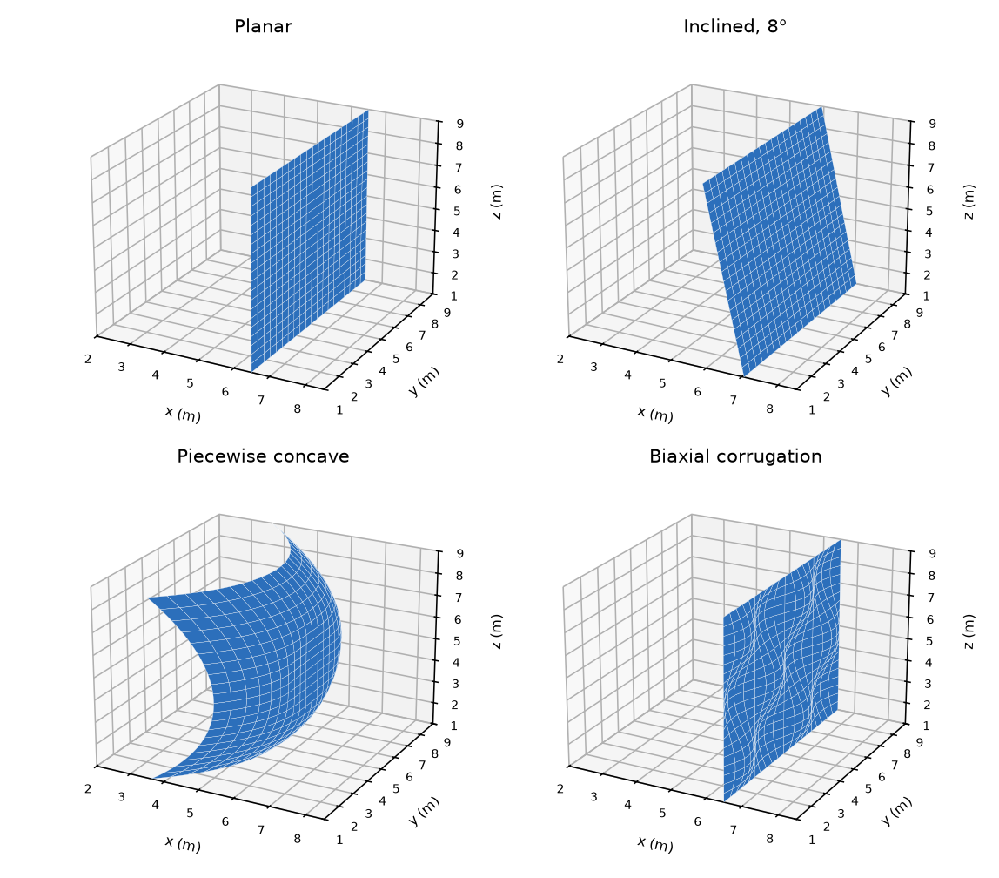
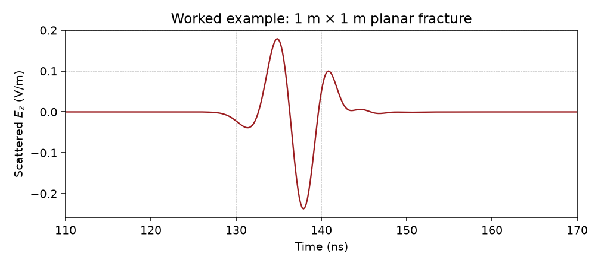

# RA-HPO: Ray-Aligned Hybrid Physical Optics borehole-radar forward solver

[](LICENSE)
[](environment.yml)

RA-HPO computes three-dimensional borehole-radar responses of fluid-filled fractures. One
finite-difference time-domain (FDTD) simulation with [gprMax](https://www.gprmax.com) resolves
the borehole and the antenna and records the six-component field on a reference plane. RA-HPO
propagates that field along rays to a meshed fracture surface, scatters it by physical optics
with three-layer TE/TM reflection coefficients, and couples the scattered field back to the
receiver through electromagnetic reciprocity.

The method applies to fractures beyond the reference plane, in a homogeneous host rock, that do
not intersect the borehole and whose surfaces are single-valued as seen from the plane.

This repository contains the solver (`rahpo`), a worked example, and the scripts that
reproduce the paper (see [Citation](#citation)). The cases of the paper are not part of
the solver. They live in [`examples/`](examples/) and are documented in
[docs/library.md](docs/library.md).

The four fracture shapes below are drawn by [`examples/showcase.py`](examples/showcase.py)
from the same surface function the solver meshes. The trace is the worked example
shipped in `examples/example_reference.npz`: a 1 m by 1 m planar fracture, shown over
the arrival of the reflection.





## Contents

- [Installation](#installation)
- [Quick start](#quick-start)
- [Using the library](docs/library.md)
- [Running the solver](#running-the-solver)
- [Reproducing the paper](#reproducing-the-paper)
- [Repository layout](#repository-layout)
- [File formats](#file-formats)
- [Compute requirements](#compute-requirements)
- [Data](#data)
- [Citation](#citation)
- [License](#license)

## Installation

```bash
git clone https://github.com/GeoHEAT/WP5T1_borehole_radar_forward_solver.git
cd WP5T1_borehole_radar_forward_solver
conda env create -f environment.yml            # solver and gprMax (Python 3.11)
conda env create -f environment-analysis.yml   # figures and tables (Python 3.12)
conda activate rahpo
pip install -e ".[dev]"                 # importable package; pytest comes with the dev extra
```

The solver needs NumPy, SciPy, Matplotlib, h5py and joblib. Without joblib it runs serially.

gprMax 3.1.7 is needed only to compute reference planes and full-domain reference solutions. It
is built from source inside the `rahpo` environment, and the header of
[environment.yml](environment.yml) gives the two build commands. The analysis scripts run in
either environment. `environment-analysis.yml` pins the versions that produced the figures and
tables of the paper.

## Quick start

The worked example computes the response of a 1 x 1 m planar fracture at the specular point of
the paper's geometry and checks it against a stored trace. Its reference plane,
`examples/example_plane.h5` (19 MB), is a cut of the paper's reference plane, 45 x 30 receivers
at 0.04 m over y = 4.42 to 5.58 m and z = 4.62 to 6.38 m, decimated in time by 8. From the
repository root:

```bash
python ra_hpo.py --tx_plane_file examples/example_plane.h5 --rx_plane_file examples/example_plane.h5 \
    --fracture_type planar --fracture_extent 4.5 5.5 4.5 5.5 --cores 4 --no_viz --output_name example
python tools/check_example.py examples/example_reference.npz output/traces/example.npz
```

Expected output of the check:

```
example check: chi 0.0000 %  peak ratio (reference/trace) 1.00000  peak-time diff +0.0000 ns  over 0.0-240.8 ns -> PASS (max 1.0 %)
```

The run takes about 10 s on a laptop. The line `[DROPPED] 0 of 10000 elements` in
`output/logs/example.log` confirms that every ray to the fracture crosses the cut plane.

The tests check single components of the solver and need no data:

```bash
pytest
```

## Running the solver

`ra_hpo.py` in the repository root is the command used in the paper. It contains no solver
code: it calls `rahpo.cli`, and the method lives in the `rahpo` package. The same command
line is `python -m rahpo`. After `pip install -e .`, the installed `rahpo` script does that
too. `tools/run_case.py` prints `python ra_hpo.py` so a case can be copied as it appears in
the paper.

```bash
python ra_hpo.py --tx_plane_file PLANE --rx_plane_file PLANE [options] --output_name NAME
```

The reference plane is a gprMax `.out` file or a plane converted with `tools/convert_plane.py`. When
the transmitter and receiver plane files are the same, the reciprocal field is obtained by
shifting the forward field along the borehole axis, so one FDTD simulation serves both. A
separate receiver plane is needed when the near-field environment of the receiver differs from
that of the transmitter, for example with antenna arms that are not symmetric about the feed.

Each run writes `output/traces/NAME.npz` (the trace), `output/images/NAME.png` (a plot of the
trace) and `output/logs/NAME.log`. With `--no_viz` omitted, the geometry plot is
`output/images/RA_HPO_Geometry_Surface.png`. These folders are created when the package is
imported, which is the first thing `python ra_hpo.py` does.

| Option | Default | Meaning |
|---|---|---|
| `--target_res` | as recorded | Receiver spacing (m) at which to read the plane. The 0.01 m planes of the paper are read at 0.04 m |
| `--plane_epsr` | 9.0 | Permittivity of the host in which the plane was recorded, for re-radiation into a different host |
| `--fracture_type` | `planar` | `planar`, `planar-tilted` (8 degrees), `piecewise_yz` (concave bowl with a flat center) or `sinusoidal_3d` (biaxial corrugation) |
| `--amplitude` | 0.25 | Corrugation amplitude A (m) of `sinusoidal_3d` |
| `--planethick` | 0.04 | Fracture aperture (m) |
| `--fracture_extent` | 1 9 1 9 | Meshed extent YMIN YMAX ZMIN ZMAX (m) |
| `--ellength` | 0.01 | Element size (m) |
| `--element_area` | `true` | Element weight, the surface area of each element (`true`) or its projected cell (`projected`) |
| `--edge_taper` | 0 | Width (m) of a cosine-squared edge taper, to approximate an unbounded fracture |
| `--fluid_epsr`, `--fluid_sigma` | 80.0, 0.5 | Permittivity and conductivity (S/m) of the fracture fill |
| `--heterogeneous` | off | Read a heterogeneous fill from `--h5_geom`, `--syz_geom` and `--mat_file` |
| `--src_pos`, `--rec_pos` | 0.5 5.0 5.5, 0.5 5.0 4.5 | Source and receiver positions (m) |
| `--cores` | 24 | Worker processes for the element integration |
| `--incidence` | `band` | One incidence direction per element from the band-averaged Poynting vector (`band`), or a diagnostic that recomputes it per frequency (`perfreq`) |
| `--no_viz` | off | Skip the diagnostic plot of the fracture geometry |

`python ra_hpo.py --help` describes every option. Settings without an option, such as the host
rock properties and the source wavelet, are set in the dataclasses in `rahpo/parameters.py`
(`MediaParams`, `SourceParams`, `GeometryParams`, `RuntimeParams`).

**Source and receiver positions.** The reference plane is recorded for one source position, so
the source may move only along the borehole axis. Along the axis, any transmitter and receiver
pair is served by the same plane as long as the ray from each to every fracture element crosses
the plane inside its recorded aperture. An element whose ray misses the plane contributes
nothing, and the log reports the number of such elements in the line `[DROPPED]`.

**Converting a plane.** A gprMax `.out` file stores one dataset per receiver and component.
Converting it once makes each component one contiguous array, which the solver reads much
faster:

```bash
python tools/convert_plane.py --in plane.out --out plane.h5 [--target_res 0.04]
```

## Reproducing the paper

The cases of the paper are defined in [examples/cases.py](examples/cases.py), and
[examples/cases.json](examples/cases.json) lists them in machine-readable form. Every RA-HPO trace
is written as `output/traces/<case>.npz`, and the analysis scripts read it under that name. All
commands run from the repository root.

**1. Fracture geometry volumes**, read by the full-domain gprMax models:

```bash
python tools/generate_geometry_h5.py --all --out-dir examples/gprMax_models/For_full-domain_verifications/input_h5_geom
python tools/generate_heter_geometry_h5_and_materials.py --out-dir examples/gprMax_models/For_full-domain_verifications/input_h5_geom
```

**2 to 4. gprMax, plane conversion and RA-HPO, per case.**

```bash
python tools/run_case.py --list                    # the 59 cases and their groups
python tools/run_case.py finite_planar             # the commands of one case
python tools/run_case.py finite_planar --run       # run its RA-HPO command
python tools/run_case.py --commands --group roughness
```

For each case, `run_case.py` prints the gprMax runs of its reference plane, of its full-domain
reference and of the direct wave subtracted from that reference, then the conversion of the
plane and the RA-HPO command. gprMax writes each output next to its input file. Set
`#num_threads` in the `.in` files to the cores of your machine. The fractured full-domain
models also write a geometry view and field snapshots, which the traces do not need. Removing
the `#geometry_view` line and the `#python` snapshot block saves time and disk space.

**5. Metrics, tables and figures.** The analysis scripts read the gprMax outputs, the RA-HPO
traces and the geometry files from their default locations and write to `output/metrics/` and
`output/figures/`. Every FDTD and exact reference trace is passed through the Gaussian window that
`ra_hpo.py` applies to its own spectrum (`band_match` in `examples/traces.py`), so that both traces
of a comparison cover the same band.

| Result | Command | Output |
|---|---|---|
| Trace comparisons with full-domain FDTD and the exact solution | `python tools/plot_traces.py` | `output/figures/Traces_*.pdf`, `output/metrics/trace_metrics.csv` |
| Accuracy and roughness metrics, misfit decomposition, no-borehole control, domain truncation, incidence spread | `python tools/accuracy_metrics.py` | `output/metrics/accuracy_metrics.csv` and five further tables |
| Rows of Tables 2 and 3 | `python tools/make_tables.py` | printed as LaTeX |
| Discretization convergence (Supplementary Table S1) | `python tools/convergence.py --check` | `output/metrics/convergence.csv` |
| Multi-offset gather (Supplementary Table S2 and figure) | `python tools/gather.py` | `output/metrics/gather.csv`, `output/figures/Traces_gather.pdf` |
| Two-medium equivalent-source propagation | `python tools/plot_two_medium.py` | `output/figures/Traces_two_medium.pdf`, `output/metrics/trace_metrics_two_medium.csv` |
| Coda of the heterogeneous fractures | `python tools/coda_metrics.py` | `output/metrics/coda_metrics.csv` |
| Refined-grid FDTD reference | `python tools/refined_reference.py` | `output/metrics/refined_reference.csv`, `output/metrics/refined_reference_box_check.csv` |
| Exact solution for the infinite planar fracture | see [examples/analytic/](examples/analytic/README.md) | `vertical_plannar_2cm_analy_trace.csv` |
| Ray-aligned propagation test | `python tools/validate_propagation.py Ez` (also `Ex`, `Ey`) | `output/propagation/` |
| Reference plane from a truncated domain | `python tools/compare_ref_planes.py TRUNCATED.out FULL.out` | `output/comparisons/` |
| Plane recorded at 0.04 m against one recorded at 0.01 m | `python tools/compare_planes.py FINE.out COARSE.out --ref-step 4 --cand-step 1` | pass or fail |
| Geometry panels of the trace figures | `python tools/plot_surface.py` | `output/figures/*.pdf` |
| Property maps of the heterogeneous fills | `python tools/plot_heterogeneous_maps.py` | `output/figures/fig_*_ExpHeter_*.pdf` |

The propagation test needs the two models in `examples/gprMax_models/For_ray-align_propagation_verification/`.
The truncation and sampling comparisons use the models in
`examples/gprMax_models/For_referenced_plane/For_truncated_domain/` against
`examples/gprMax_models/For_referenced_plane/For_including_BH_only/`.

To keep the large files elsewhere, set a directory through an environment variable before
importing the package: `RAHPO_PLANE_DIR` (converted planes, default `output/planes/`),
`RAHPO_TRACE_DIR` (RA-HPO traces, default `output/traces/`), `RAHPO_LOG_DIR`,
`RAHPO_IMAGE_DIR`, `RAHPO_FIGURE_DIR`, `RAHPO_METRICS_DIR`, `RAHPO_PROPAGATION_DIR` and
`RAHPO_COMPARISON_DIR`. `RAHPO_FDTD_DIR` is searched for the full-domain gprMax outputs;
without it, gprMax writes each `.out` next to its input.

## Repository layout

```
rahpo/                         the solver, and nothing else
  parameters.py                dataclasses that fix one run
  fracture.py                  surface, fill, and mesh
  fields.py                    reference-plane loading and ray propagation
  scattering.py                physical-optics reaction integral
  simulation.py                one scattered trace
  paths.py                     output/ and its folders, created on import
  cli.py                       the command line
ra_hpo.py                      launcher only: calls rahpo.cli, kept for the paper's command
output/                        gitignored products of a run (created on import)
  traces/  logs/  images/  figures/  metrics/  planes/  propagation/  comparisons/
examples/                      the experiments of the paper, not the solver
  cases.py                     models, flags, and file locations of every case
  cases.json                   the same catalogue in machine-readable form
  traces.py                    loading traces and the comparison metrics
  showcase.py                  draws docs/images/
  example_plane.h5             cut of the paper's reference plane (shipped)
  example_reference.npz        trace computed from that plane (shipped)
  gprMax_models/               gprMax input files of every case, and materials.txt
  analytic/                    exact solution for the infinite planar fracture
docs/                          how to import the library, and the README pictures
tools/                         geometry, conversion, figures, metrics, case runner
tests/                         pytest; no large data
```

The gprMax models live in `examples/gprMax_models/` and are grouped by role:

| Folder | Models |
|---|---|
| `For_referenced_plane/` | Fracture-free near-field models that record the reference planes at x = 3.5 m, with the borehole, without it, with antenna arms, with the plane recorded in another host (two-medium), and on a truncated domain |
| `For_full-domain_verifications/` | Full-domain references with the fracture, and the direct-wave models subtracted from them |
| `For_gather/` | Sixteen receivers along the borehole, with and without the fracture |
| `For_refined_reference/` | The finite planar fracture and its direct wave at 0.005 m, and the same fracture written as a box at 0.01 m |
| `For_ray-align_propagation_verification/` | Planes at x = 3.5 m and x = 6.5 m for the propagation test |

## File formats

**RA-HPO trace** (`.npz`, NumPy): `time_ns`, the time axis in ns, and `amplitude`, the scattered
E_z at the receiver in V/m, both of shape (N,).

**Converted reference plane** (`.h5`): datasets `Ex`, `Ey`, `Ez`, `Hx`, `Hy`, `Hz` (float32,
shape (nz, ny, Nt)) and the receiver coordinates `yy` (ny) and `zz` (nz) in m. Attributes:
`x1` (plane position, m), `dt` (s), `Nt`, `target_res` (receiver spacing, m), `step`
(decimation applied), `format_version`, and the source file with its size and modification time.

**gprMax reference plane** (`.out`): the standard gprMax output of a model with an `#rx_array`
on the plane x = x1.

**Fracture geometry volume** (`.h5`, gprMax `#geometry_objects_read`): int16 dataset `data` with
attribute `dx_dy_dz`, fracture cells 0 and all other cells -1. Material 0 is defined in
`examples/gprMax_models/materials.txt`.

**Heterogeneous fill**: `geom_<model>.h5` and `mat_<model>.txt` for gprMax, and `Syz_<model>.h5`,
the fill on the fracture plane read by `ra_hpo.py --heterogeneous`.

## Compute requirements

The worked example and the tests run on a laptop. The cases of the paper need a compute node.

| Step | Time | Memory | Output |
|---|---|---|---|
| Reference plane of the validation cases (8.0 m domain, receivers at 0.01 m) | several hours | about 150 GB | about 94 GB |
| Reference plane on the truncated domain, receivers at 0.04 m | 2,283 s at 48 threads | 34.6 GB | 5.88 GB |
| Full-domain FDTD reference, finite planar fracture | 7,960 s at 48 threads | 57.0 GB | |
| RA-HPO, one trace of the finite planar fracture | about 150 s at 48 workers | 18.2 GB | |

These figures were measured on a node with two Intel Xeon Gold 6448Y processors (64 cores) and
250 GB of memory, with gprMax 3.1.7 on the CPU, built with GCC 13.4.0 for Python 3.11 and
NumPy 1.26.4. The two refined-grid models at 0.005 m each need about 45 h at 48 threads and
452 GB of memory.

### Timing procedure

The FDTD and RA-HPO times of the paper are per single trace of the finite planar fracture, at
n = 8, 16, 24 and 48 threads (RA-HPO also serially), each run with exclusive use of the node.

- **FDTD.** The finite planar model with `#num_threads: n`, and its `#geometry_view` line and
  snapshot block removed, run as
  `OMP_NUM_THREADS=n OMP_PLACES=cores OMP_PROC_BIND=close python -m gprMax examples/gprMax_models/For_full-domain_verifications/3D8x10x10-shifted_frac-dist6-4h_planar_h0pt01.in`.
  One discarded warm-up, then two timed runs. The time is the one gprMax prints as
  `Simulation completed in`.
- **RA-HPO.** `python ra_hpo.py --tx_plane_file PLANE.h5 --rx_plane_file PLANE.h5 --target_res 0.04 --fracture_type planar --cores n --no_viz --output_name timing`,
  with `PLANE.h5` a converted plane at 0.04 m, under
  `OMP_NUM_THREADS=1 MKL_NUM_THREADS=1 OPENBLAS_NUM_THREADS=1` and without core binding. Its
  parallelism is in worker processes, and an OpenMP binding inherited by every worker would place
  them all on one core. One discarded warm-up, then five timed runs. The time is the sum of the
  phases in the line `[PHASE]` of the log, which includes reading the converted plane but not
  interpreter start-up.
- **Reference plane.** The truncated-domain model
  `examples/gprMax_models/For_referenced_plane/For_truncated_domain/3D_4x10x10-shifted_nofrac_planex3_h0pt01_rx0pt04.in`
  at 48 threads under the FDTD settings above, then `python tools/convert_plane.py` on its output.

## Data

Plots, PDF figures, NumPy archives, and HDF5 files produced by a run are not kept in git.
Importing `rahpo` creates `output/` with `traces/`, `logs/`, `images/`, `figures/`,
`metrics/`, `planes/`, `propagation/` and `comparisons/`. An editable install
(`pip install -e .`) puts that tree next to the repository, because the package directory's
parent is the repository. The same rule covers a `*.png`, `*.pdf`, `*.npz`, or `*.h5` left
anywhere else in the tree. gprMax geometry volumes stay beside the `.in` files that read them.

Three things are tracked because the repository cannot rebuild them from the code alone:

- `examples/example_plane.h5` and `examples/example_reference.npz`, the quick-start inputs.
  The plane is a cut of the paper's reference plane; regenerating it needs the gprMax run.
- `docs/images/*.png`, the two pictures in this README. Redraw them with
  `python examples/showcase.py`.
- `examples/analytic/vertical_plannar_2cm_analy_trace.csv`, the exact trace for the infinite
  planar fracture.

The reference planes, full-domain FDTD traces, RA-HPO traces, and fracture geometry volumes
reported in the paper are not distributed. They can be regenerated from the scripts and the
gprMax input files, and `tools/run_case.py` gives the commands for each case.

## Citation

If you use RA-HPO, please cite:

> J. Chen, A. Shakas, E. Slob. A Ray-Aligned Hybrid Physical Optics Method for Fast 3D Borehole
> Radar Modeling of Fluid-Filled Fractures. Submitted to *Computers & Geosciences*.

[CITATION.cff](CITATION.cff) holds the same reference in machine-readable form.

## License

MIT, see [LICENSE](LICENSE). gprMax is a separate package under its own license and is not
distributed here.

Contact: Jinqiang Chen, j.chen-11@tudelft.nl
